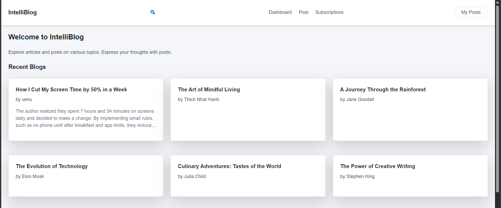
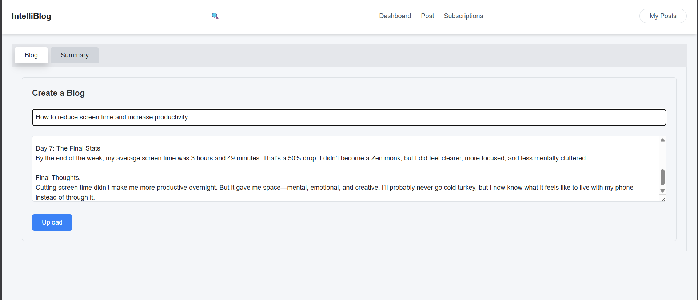
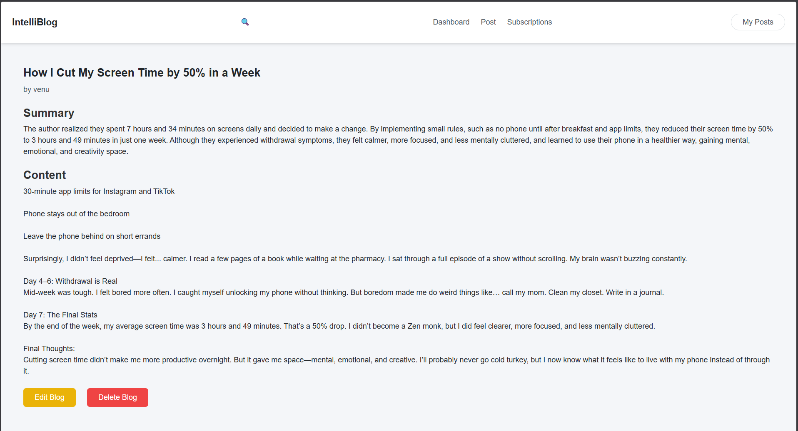
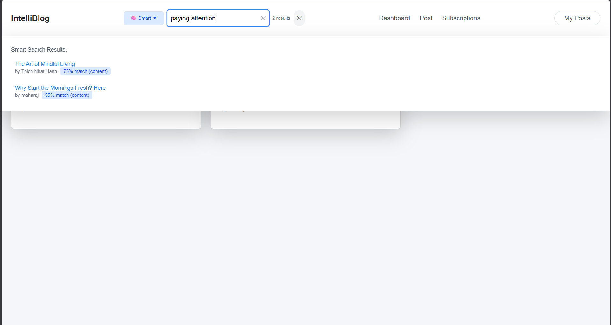
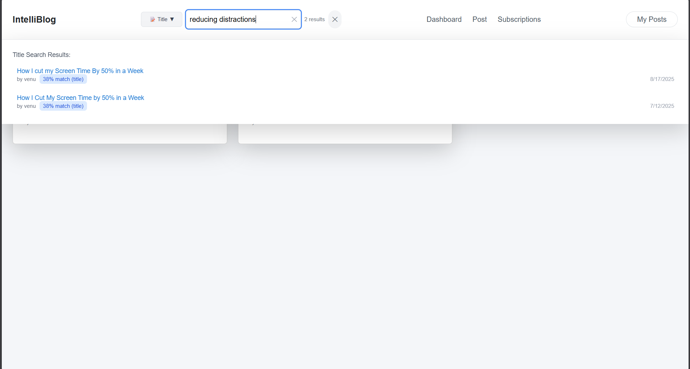
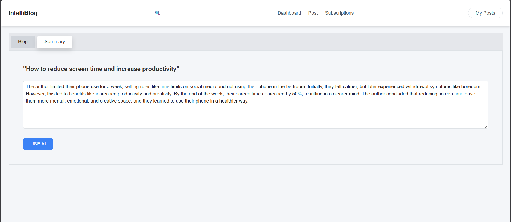
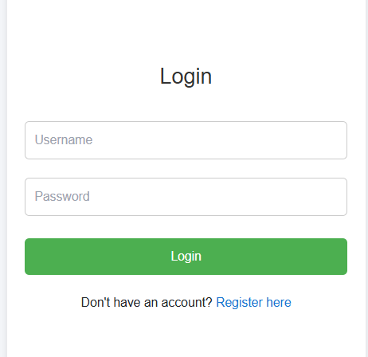
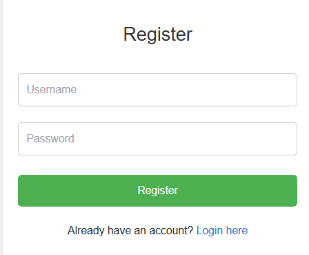
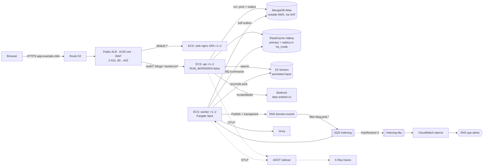

# BlogPlatform

A full-stack blogging platform with AI-powered features: semantic search, title similarity search, question answering over the posts, and automatic summarization. It has a Node/Express backend (`blog-api`), a React frontend (`frontend`) and Terraform for AWS (`infra`). Posts live in MongoDB; a vector store holds their embeddings.

## Key features
- Create, edit and view blog posts, with likes, comments, replies and real-time updates (Socket.IO)
- Title-based semantic similarity search (find posts by similar titles)
- Content semantic search (query by meaning using vector embeddings)
- Ask a question and get an answer grounded in the posts (RAG)
- AI summarization of blog content
- Author and snippet metadata returned with search results

## Screenshots
- Dashboard: images/Dashboard.png  
  

- Create / Posting: images/Posting.png  
  

- View post: images/View.png  
  

- Semantic search (content): images/SemanticSearch.png  
  Demonstrates similarity search of blog posts based on semantic similarity of content and query.  
  

- Title search: images/TitleSearch.png  
  Demonstrates title-based semantic similarity search of blog posts.  
  

- Summarization: images/Summarize.png  
  Demonstrates AI-based summarization of blog content.  
  

- Login and Register (side-by-side, small width):  
  <table><tr>
  <td></td>
  <td></td>
  </tr></table>

## How it works (brief)
- When a post is created or updated, the backend embeds it and writes the vectors to the vector store: one for the title, one for each chunk of the content, and one for the summary, in three collections.
- Semantic search: the query is embedded, then the vector store returns the nearest vectors (content or title). Results carry payload metadata (blogId, title, snippet, author). The backend drops results whose similarity is below a threshold (0.2 for content search, 0.3 for title search by default, 0.1 for questions); the frontend applies no further filter.
- Title search: a focused search against the title vectors.
- Ask: retrieves the closest chunks and has the LLM answer from them.
- Summarization: an LLM produces a shorter summary of the post on demand, through a BullMQ job.
- The vector index is a derived view. MongoDB is the only source of truth, and a reconcile step can rebuild any post's vectors from it.

### Providers
| Concern | Options | Default |
|---|---|---|
| Embeddings (`EMBEDDING_PROVIDER`) | `local` (sentence-transformers), `huggingface`, `bedrock` (Titan Text Embeddings V2) | `bedrock`, 512 dimensions, in the AWS deployment |
| Answers to questions (`LLM_PROVIDER`) | `groq`, `bedrock` | `groq` |
| Summaries (`SUMMARY_PROVIDER`) | `groq`, `bedrock` | `groq` in the AWS deployment |

The Bedrock LLM path exists in code but is shelved; see [docs/audit/SHELVED_BEDROCK_LLM.md](docs/audit/SHELVED_BEDROCK_LLM.md).
| Vector store (`VECTOR_STORE`) | `qdrant`, `s3vectors` | `qdrant` |

Embeddings are not cached.

## Architecture on AWS

Region `ap-south-1`. The picture below is the target; the parts marked in the table are switched on by Terraform variables and are **off by default**, so a plain `apply` gives the legacy shape (API with in-process BullMQ workers, Redis and Qdrant on Fargate, HTTP on the ALB).



| Part | Switch (Terraform) | Default |
|---|---|---|
| Separate worker service, outbox relay, SNS/SQS indexing | `enable_worker_service`, `enable_domain_events` | off |
| Lambda instead of the ECS consumer | `indexing_consumer_runtime` | `ecs` |
| ElastiCache Valkey instead of Redis on Fargate | `redis_mode` | `fargate` |
| S3 Vectors instead of Qdrant | `vector_store` | `qdrant` |
| HTTPS, web service, CloudFront variant | `edge_mode`, `domain_name` | `alb_http` |
| WAF, tracing, per-AZ NAT and Valkey replica | `enable_waf`, `enable_tracing`, `ha_mode` | off |
| Cognito sign-in | `auth_provider` | `app` (the app's own JWT) |

Everything else (VPC, ALB, ECS, EFS-backed Redis and Qdrant in the default shape, a single NAT) is always on. A single NAT, Redis, Qdrant and API task is **not** highly available; `ha_mode` is what adds the second AZ's NAT and the Valkey replica. CloudFront is not deployed: the account is unverified for it (see T21C in [docs/audit/IMPLEMENTATION_PLAN.md](docs/audit/IMPLEMENTATION_PLAN.md)).

The design, its decisions and the audit that led to it are in [docs/audit/TARGET_ARCHITECTURE.md](docs/audit/TARGET_ARCHITECTURE.md) and [docs/audit/AWS_AUDIT.md](docs/audit/AWS_AUDIT.md).

## Deploying to AWS

The infrastructure is three Terraform stacks, applied in this order: `bootstrap` (the state bucket), `persistent` (ECR, secrets, DNS and certificate, anything that outlives a session) and `ephemeral` (the running system, created for a session and destroyed after). CI then deploys code.

```bash
cd infra/bootstrap
terraform init
terraform apply -var="bucket_name=my-unique-blogplatform-state-bucket"

cd ../persistent
terraform init -backend-config="bucket=my-unique-blogplatform-state-bucket"
terraform apply

cd ../ephemeral
terraform init -backend-config="bucket=my-unique-blogplatform-state-bucket"
terraform apply -var state_bucket=my-unique-blogplatform-state-bucket -var api_image_tag=<git sha already in ECR>
```

Once the state bucket exists, `make up` and `make down` (see [infra/README.md](infra/README.md)) run a whole session. Pushes to `main` build the images, tag them with the commit SHA (tags are immutable) and deploy them through GitHub Actions. [infra/README.md](infra/README.md) has the feature flags, the checks that need no AWS access, and every step that only the repository owner can do. The first-time list of accounts and tools is in [docs/PREREQUISITES.md](docs/PREREQUISITES.md).

## Local development

Prerequisites
- Node.js 22 or newer (the API declares `>=22`; the images use Node 24)
- npm
- MongoDB (or a MongoDB Atlas connection string). The outbox needs a replica set, so use Atlas or a local replica set.
- **Redis** (required: the API exits at start without `REDIS_URL`, and BullMQ and Socket.IO use it)
- Qdrant, locally or remote (default `http://localhost:6333`), unless `VECTOR_STORE=s3vectors`
- For embeddings, a local embedding setup, a Hugging Face API token, or AWS credentials with Bedrock access
- For summaries and answers, a Groq API key

`docker-compose.yml` starts the API with Redis and Qdrant.

## Tech stack
- Backend: Node.js, Express, Mongoose, BullMQ, Socket.IO
- Data: MongoDB Atlas; Redis (ElastiCache Valkey on AWS); Qdrant or Amazon S3 Vectors
- AI: Amazon Bedrock (Titan Text Embeddings V2) or a local model for embeddings; Groq for LLM calls
- Messaging: SNS and SQS (domain events, behind a flag)
- Frontend: React
- Infrastructure: Terraform, ECS Fargate, ALB, WAF, ACM and Route 53, CloudWatch, X-Ray, GitHub Actions
- Auth: the app's own JWT, or Amazon Cognito (flag)
